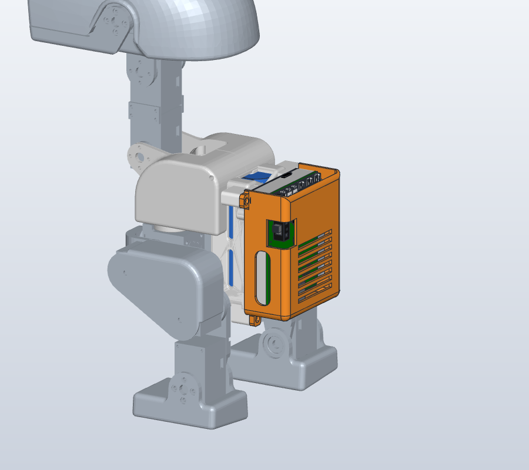
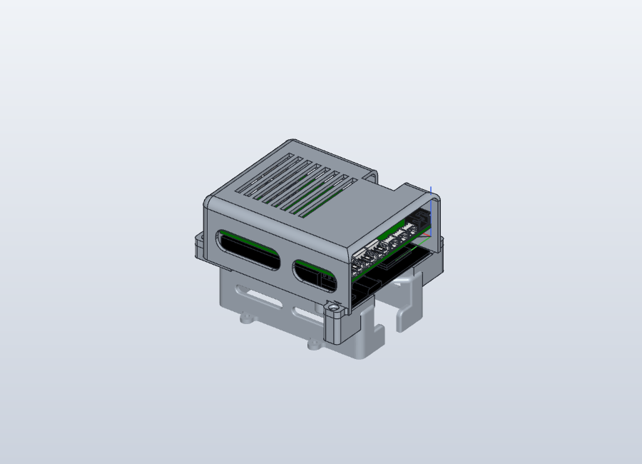
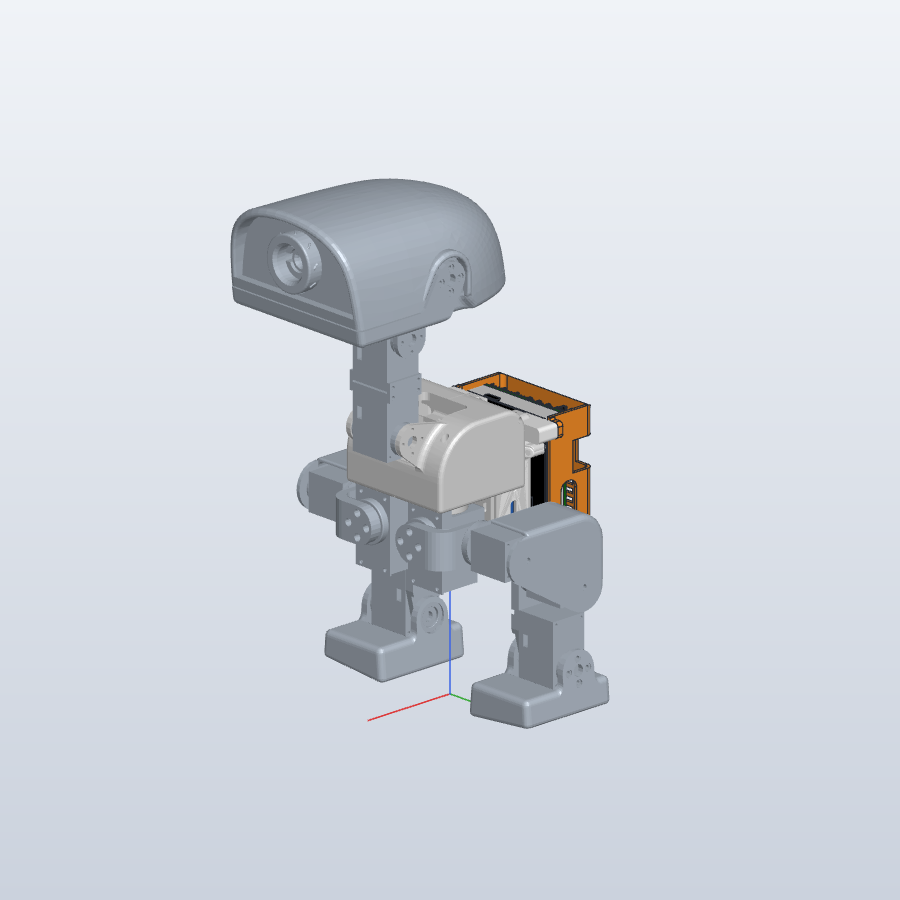

# Back cover and battery mount

[Project](../readme.md) · [Printing inventory](PRINTING.md) · [Build guide](BUILD_GUIDE.md)

A rigid, screw-on back cover that protects the Arduino UNO Q and Luwu expansion-board stack on the back of XGO-Duck. It mounts onto a modified battery case, so knocks go into the robot's structure instead of the boards. The cover keeps a gap all round the boards and never touches them.

This fork's build uses two printed parts in place of upstream's `battery.stl`:

- **[battery_mount.stl](../structure/battery_mount.stl)**: the upstream battery case with four short screw bosses added. Print it **instead of** `battery.stl`. It fits the robot and the UNO Q exactly as the original case does.
- **[back_cover.stl](../structure/back_cover.stl)**: the cover itself, held on by four screws into those bosses.

 

## Files

| File | Contents |
| --- | --- |
| [structure/back_cover.stl](../structure/back_cover.stl) | Print file for the cover, already oriented roof down |
| [structure/battery_mount.stl](../structure/battery_mount.stl) | Print file for the battery case with screw bosses (replaces `battery.stl`), in the same orientation as `battery.stl` |
| [structure/source/back_cover.step](../structure/source/back_cover.step) | The cover and the four bosses as exact solids, for other CAD tools |
| [structure/source/back_cover.solidcraft](../structure/source/back_cover.solidcraft) | Editable SolidCraft design: the cover and boss feature history, with the UNO Q, expansion board and battery case they were fitted against |
| [structure/assembly/xgoduck_full_assembly.solidcraft](../structure/assembly/xgoduck_full_assembly.solidcraft) | Whole-robot fit-check assembly with the cover and battery mount fitted (see below) |
| [structure/assembly/xgoduck_full_assembly.step](../structure/assembly/xgoduck_full_assembly.step) | The same assembly as STEP (AP242, 45 MB) for Fusion, SolidWorks, Onshape, FreeCAD and other CAD tools |
| [media/back_cover/](../media/back_cover/) | Renders used on this page |

## What you need

| Item | Quantity | Notes |
| --- | ---: | --- |
| `battery_mount.stl` | 1 | Printed instead of `battery.stl` |
| `back_cover.stl` | 1 | |
| M2 × 6 countersunk self-tapping screw | 4 | BOM item 7, the same screws used elsewhere on the robot |
| Screwdriver | 1 | Its shaft must be at least about 25 mm long to reach past the cover's top edge. No special long-shaft driver is needed. |

## Printing

- **Material:** PETG for both parts, with at least 3 perimeters so the bosses and screw holes are strong.
- **Back cover:** print roof down, as the STL is oriented. It needs no supports.
- **Battery mount:** print body side down, the same way you would print `battery.stl`.
  - The two bosses at the cable end stick out sideways from the case, so let the slicer add small supports under them.
  - The bosses are separate shells overlapping the original case in the same STL. Slicers fuse them when slicing, but check the preview shows them joined to the case.
  - Whatever supports the original case needs still apply.

## Assembly

1. **Build the robot with the battery mount.** Follow the [assembly guide](../Assembly_Guide.pdf), using `battery_mount.stl` wherever it shows the battery case.
2. **Fit the battery and the boards as usual.** The UNO Q sits on the case's four standoffs with its two underside connectors in the case slots, held by the M3 × 16 screws. Connect all cables.
3. **Fit the cover.**
   - Lower it straight over the board stack with the open end at the cable end, towards the neck. The power switch lines up with the notch in the side wall.
   - Each of the four ears sits on a boss. Drive an M2 × 6 screw through each ear: two at the bottom end and two on the side walls next to the cable end.
4. **Check the switch, DC jack and cables.** The switch should move freely through its notch, a charger plug should reach the DC jack, and no cable should be pinched.

**Already built your robot with `battery.stl`?** You need to reprint the battery case as `battery_mount.stl` and swap it in, because the cover's screws go into the new bosses. The earlier clip-on cover that fitted without any changes has been retired, because it passed knocks straight to the boards. It is still in this fork's git history.

## How it works

- **Knocks go into the frame, not the boards.** The cover is a rigid shell with rounded edges. It touches only the four battery-mount bosses and keeps at least 2 mm from the boards on all sides, including:
  - 2.5 mm above the DC jack, the tallest part
  - 2 mm from the battery connector
- **Screws are safe for the battery.** All the bosses and screw holes stay above the plate that separates the board from the cells. No screw can reach the cell compartment.
- **Openings:**
  - **Cable end:** fully open, so the servo, Molex and battery cables and the UNO Q USB-C are unobstructed.
  - **Power switch:** a 16 mm notch open from the side through the roof edge.
  - **Bottom end wall:** openings for the expansion board's DC barrel jack and the UNO Q's side connector.
  - **Cooling:** rounded windows in the walls and eight roof vents.
- **Size and mass:** about 74 × 61 × 28 mm, not counting the screw ears. The cover weighs about 16 g, and the bosses add about 8 g to the battery case.

### Assumption to check on your robot

The cover is sized for the UNO Q seated directly on the battery case's standoffs, with its underside connectors in the case slots. That puts the expansion board's top surface about 13.7 mm above the tops of the battery case's standoffs. If your stack sits higher, for example on extra spacers, the DC jack will hit the roof.

## Whole-robot fit check

[xgoduck_full_assembly.solidcraft](../structure/assembly/xgoduck_full_assembly.solidcraft) shows the cover and battery mount on a complete robot so clearances can be inspected. [xgoduck_full_assembly.step](../structure/assembly/xgoduck_full_assembly.step) carries the same parts, names, colours and placement for other CAD tools:

- The UNO Q, expansion board, back cover and battery cells are exact solids.
- The robot links and the battery mount come from triangle meshes, so they are faceted. They can be measured and checked for interference, but not edited as features.
- The robot is fixed in its zero pose. For moving joints, use the xgoduck_rl simulation model.

| Component | Source |
| --- | --- |
| Robot links (trunk, legs, neck, head) | Zero-pose link meshes from the [xgoduck_rl](https://github.com/LuwuDynamics/xgoduck_rl) MuJoCo model (`robot/xgoduck/robot_walk.xml`) |
| UNO Q | Arduino's official simplified STEP (ABX00162) |
| Expansion board | [PCBA/ArduinoUnoQ.step](../PCBA/ArduinoUnoQ.step) |
| Battery mount | [structure/battery_mount.stl](../structure/battery_mount.stl), registered onto the trunk together with [structure/body.stl](../structure/body.stl), which shares its CAD frame |
| Back cover | [structure/source/back_cover.step](../structure/source/back_cover.step) |
| Battery | Two 18650 cells (Ø18.5 × 65.5 mm including wrap) as a 2S 8.4 V pack, with a series nickel strip |

 

Results in SolidCraft:

- **No contact:** the cover touches nothing except the battery-mount bosses.
- **Legs:** at the zero pose the nearest leg is about 7.8 mm from the cover and 8.3 mm from the bosses. Hip pitch, roll and yaw sweeps were not simulated for this cover.
- **Board position:** the UNO Q sits on the battery case's standoffs, with its underside connectors in the case slots. That is 6.9 mm closer to the body than in this fork's earlier assembly, which only estimated the stack position.
- **Cell fit:** the 2S pack fits the case cavity (39.1 × 18.6 × 67.1 mm) with about 1 mm at the sides, 0.55 mm at the rear and 1.3 mm at the ends.
  - Protected 18650 cells, often 67–69 mm long, will **not** fit.
  - Use unprotected cells with a separate 2S BMS. There is no room for the BMS at the cell ends.

## Measured mass

The complete robot weighed **825 g** with battery, boards and the earlier clip-on cover. The back cover and battery-mount bosses add about 11 g net, so expect roughly 836 g. This has not been weighed yet.

### Used for training

The assembly's frame is the simulation model's trunk frame, offset 129.394 mm upward. The [xgoduck_rl `cad-battery` branch](https://github.com/jimbruges/xgoduck_rl/tree/cad-battery) took its added masses from this fork's **earlier** assembly:

| Mass | Position in the trunk frame | Estimated mass |
| --- | --- | ---: |
| 2S pack + battery case | x −20, z −31 mm | ~95 g |
| UNO Q + expansion board + cover + connectors | x −51, z −31 mm | ~48 g |

These need updating for the current design:

- The board stack now sits 6.9 mm closer to the body.
- The cover is about 3 g heavier than the clip-on one.
- The bosses add about 8 g to the battery case.

The assembly uses one default density for every part, so the masses are estimates scaled to the measured total. Weighing the pack and the UNO Q stack separately would pin them down.

## Credits

UNO Q 3D model © Arduino. The robot link meshes derive from the XGO-Duck simulation model by Luwu Dynamics, which is itself based on Microduck by Pollen Robotics. See [UPSTREAM.md](../UPSTREAM.md) and [LICENSING.md](../LICENSING.md) for the terms that apply to those models.
