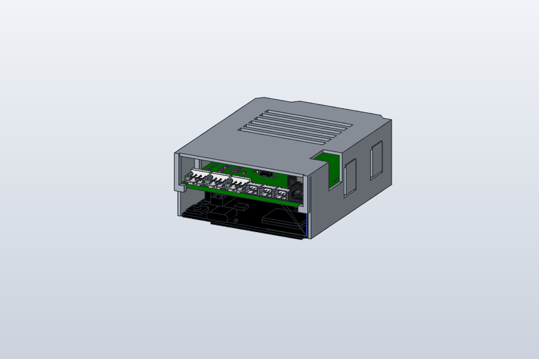
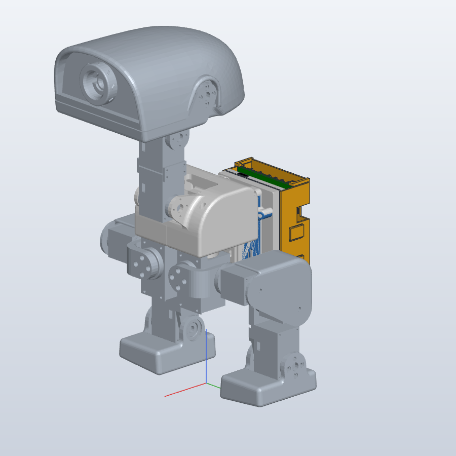
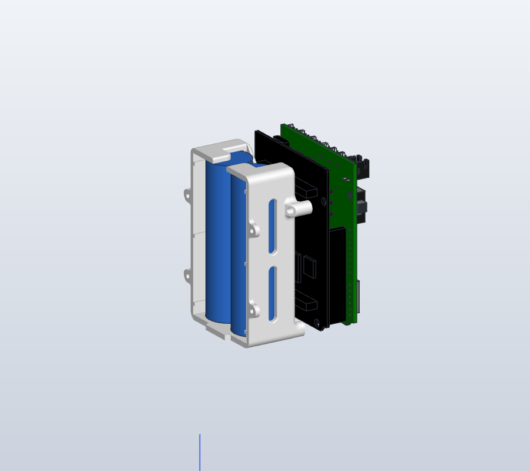

# UNO Q + expansion-board cover

[Project](../readme.md) · [Printing inventory](PRINTING.md) · [Build guide](BUILD_GUIDE.md)

A lightweight clip-on cover for the Arduino UNO Q and Luwu expansion-board stack on the back of XGO-Duck. It is designed to **retrofit an already-built robot**. No printed part is modified, no screws are removed, and every cable stays connected.

## Files

| File | Contents |
| --- | --- |
| [structure/uno_q_cover.stl](../structure/uno_q_cover.stl) | Print file |
| [structure/source/uno_q_cover.step](../structure/source/uno_q_cover.step) | Cover solid for other CAD tools |
| [structure/source/uno_q_cover.solidcraft](../structure/source/uno_q_cover.solidcraft) | Editable SolidCraft design: the cover's feature history plus the UNO Q and expansion-board models it was fitted against |
| [structure/assembly/xgoduck_full_assembly.solidcraft](../structure/assembly/xgoduck_full_assembly.solidcraft) | Whole-robot fit-check assembly (see below) |
| [media/uno_q_cover/](../media/uno_q_cover/) | Renders used on this page |

## How the cover works

- **Covers both boards.** The shell wraps the UNO Q and the expansion board, from the top of the shield down to the underside of the UNO Q's PCB. Walls are 1.2 mm with 0.4 mm clearance to the board outline (≈ 72.6 × 57.4 × 26.2 mm overall).
- **Clip-on, tool-free.** Two snap tabs on each long side carry a ramped lip. The lip rides over the expansion-board edge and catches 0.6 mm under it. Ribs from the roof rest on the board's top edge so the cover cannot be pushed further down. Pull the tabs outward to remove it.
- **Cable end fully open.** The servo, Molex and battery connectors and the UNO Q USB‑C all sit on one edge, facing the neck on the robot. That end is left open, so no cable has to be rerouted. Corner tabs locate the cover sideways.
- **Other openings.** Power-switch access, the expansion board's DC barrel jack, the connector on the UNO Q's opposite edge, and roof vent slots.
- **Mass** about 12–13 g in PLA/PETG.

### Printing

Print roof down, no supports. PETG is preferred for the snap tabs (≈ 1 % bending strain). PLA works, but the tabs may fatigue with repeated removal.

### Assumptions to check on your robot

| Assumption | Why it matters |
| --- | --- |
| Shield sits on standard 2.54 mm headers, its PCB 11.0–12.6 mm above the UNO Q top face | Snap-lip height |
| Nothing behind the UNO Q protrudes past the board outline | Wall length toward the body |
| Roof clearance of 1.3 mm over the DC jack (tallest part) | Roof height |

## Whole-robot fit check

[xgoduck_full_assembly.solidcraft](../structure/assembly/xgoduck_full_assembly.solidcraft) places the cover on a complete robot so clearances can be inspected.

| Component | Source |
| --- | --- |
| Robot links (trunk, legs, neck, head) | Zero-pose link meshes from the [xgoduck_rl](https://github.com/LuwuDynamics/xgoduck_rl) MuJoCo model (`robot/xgoduck/robot_walk.xml`) |
| UNO Q | Arduino's official simplified STEP (ABX00162) |
| Expansion board | [PCBA/ArduinoUnoQ.step](../PCBA/ArduinoUnoQ.step) |
| Battery case | [structure/battery.stl](../structure/battery.stl), registered onto the trunk together with [structure/body.stl](../structure/body.stl), which shares its CAD frame |
| Battery | Two 18650 cells (Ø18.5 × 65.5 mm including wrap) as a 2S 8.4 V pack, with a series nickel strip |

 

Results in SolidCraft:

- At the zero pose the cover does not touch the trunk, battery, boards, neck or legs. Each thigh is about 9 mm away.
- With a leg rolled fully inward (−22° hip roll), the thigh still stays at least 10.7 mm in front of the cover.
- The 2S pack fits the case cavity (39.1 × 18.6 × 67.1 mm) with about 1 mm at the sides, 0.55 mm at the rear and 1.3 mm at the ends. Protected 18650 cells, often 67–69 mm long, will **not** fit. Use unprotected cells with a separate 2S BMS; there is no room for it at the cell ends.
- Hip pitch and yaw sweeps and combined poses were not simulated.

The UNO Q stack's distance from the body is an estimate: the UNO Q's underside connectors are assumed to touch the trunk's electronics envelope. If your stack sits further out, the cover moves straight back with it.

## Measured mass

The complete robot **with battery, back case (this cover) and boards weighs 825 g**.

### Used for training

The assembly's frame is the simulation model's trunk frame, offset 129.394 mm upward. The [xgoduck_rl `cad-battery` branch](https://github.com/jimbruges/xgoduck_rl/tree/cad-battery) takes its added masses from this assembly:

| Mass | Position in the trunk frame | Estimated mass |
| --- | --- | ---: |
| 2S pack + battery case | x −20, z −31 mm | ~95 g |
| UNO Q + expansion board + cover + connectors | x −51, z −31 mm | ~48 g |

The assembly uses one default density for every part, so these masses are estimates scaled to add up to the measured 825 g. Weighing the pack and the UNO Q stack separately would pin them down.

## Credits

UNO Q 3D model © Arduino. The robot link meshes derive from the XGO-Duck simulation model by Luwu Dynamics, which is itself based on Microduck by Pollen Robotics. See [UPSTREAM.md](../UPSTREAM.md) and [LICENSING.md](../LICENSING.md) for the terms that apply to those models.
